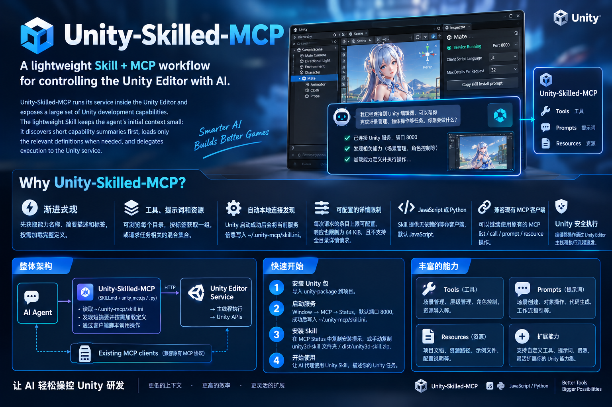

[English](README.md) | [中文](README.zh-CN.md)

---

# Unity Skilled MCP

**A lightweight Skill + MCP workflow for controlling the Unity Editor with AI.**

Unity Skilled MCP runs its service inside the Unity Editor and exposes a large set of Unity development capabilities. The lightweight Skill keeps the agent's initial context small: it discovers short capability summaries first, loads only the relevant definitions when needed, and delegates execution to the Unity service.



## Why Skill + MCP?

- **Progressive discovery:** start with capability names, short descriptions, and tags; retrieve only the schemas you actually need, one at a time or several per request.
- **Tools, prompts, and resources:** browse each catalog, retrieve a tagged group, or request a task-specific mixed set.
- **Automatic local connection discovery:** Unity writes the active service information to `~/.unity-mcp/skill.ini` whenever the service starts successfully.
- **Configurable detail limits:** the per-request item limit is configurable in Unity; the response is also capped at 64 KiB, and full-catalog detail requests are rejected.
- **JavaScript or Python:** the Skill includes equivalent dependency-free clients. JavaScript is the default.
- **Legacy MCP compatibility:** existing clients can continue using the original MCP list, call, prompt, and resource operations.
- **Engine-level control:** build the player, switch platforms, manage build scenes, read or change engine settings, inspect compilation, and control the editor selection and active tool.
- **Unity-safe execution:** editor operations are dispatched through the Unity Editor's main-thread execution flow.

## Architecture

```text
AI agent
  └─ Unity Skill (SKILL.md + unity_mcp.js / unity_mcp.py)
       ├─ Reads ~/.unity-mcp/skill.ini and validates the active service
       ├─ Discovers short summaries and selected capability definitions over HTTP
       └─ Invokes the requested operation through the client script
            └─ Unity Editor service → main-thread execution → Unity APIs

Existing MCP clients ────────────────────────────────┘
```

The Skill is the recommended path for agents that support local Skills. Do not have an agent bypass the Skill and construct MCP requests itself. The INI intentionally does **not** contain an MCP endpoint field.

## Quick start

### 1. Install the Unity package

Import the `unity-package` folder into a Unity project using your normal package workflow.

### 2. Start the service

In Unity, open **Window → MCP → Status**, review the service settings, and start the server. The default port is `8000`. On every successful start, Unity writes the current connection and Skill runtime settings to:

```text
~/.unity-mcp/skill.ini
```

Changing the port takes effect when the service is restarted. The most recently started Unity project publishes the active connection information to this file.

### 3. Install the Skill

Recommended: in the MCP Status window, click **Copy skill install prompt** and paste the prompt into your AI agent. It includes the Skill installation instructions and the Skill folder's resolved disk path.

You can also install it manually:

- Copy `unity-package/Skills/unity3d-skill/` into the agent's Skills directory, keeping the folder name `unity3d-skill`.
- Or use the packaged archive at `dist/unity3d-skill.zip`.

### 4. Use it from the agent

Ask the agent to use the Unity Skill, then describe the Unity task in natural language. The Skill guides the agent to verify the connection, discover the relevant capability, read its definition, and invoke it.

## Unity settings and connection file

The MCP Status window exposes the client runtime and the maximum number of capability details returned by one request. These settings are published on the next successful service start.

| Setting | Values | Default / behavior |
| --- | --- | --- |
| Service port | Valid port number | `8000` |
| Client script language | `js` or `python` | `js`; selects the client runtime the Skill should use |
| Maximum details per request | Non-negative integer | `32`; `0` removes the item-count limit |

The response-size limit remains **65,536 UTF-8 bytes** even when the item-count limit is `0`. A request that selects every available capability is rejected. The service does not silently truncate an oversized result.

Example `~/.unity-mcp/skill.ini`:

```ini
[unity3d-skilled-mcp]
base_url=http://localhost:8000
port=8000
project_path=/path/to/UnityProject
process_id=12345
updated_at=2026-10-30T02:00:00.0000000Z
script_language=js
max_details=32
```

The file contains local connection metadata and runtime settings, but **does not publish `mcp_url`**. The Skill client reads the file dynamically on each command and validates the service before proceeding; it does not scan ports or automatically replay failed write operations.

## How progressive discovery works

1. **Verify the service:** read the INI and check the current service's discovery metadata.
2. **Browse summaries:** read groups or a specific tools, prompts, or resources catalog.
3. **Load only what is needed:** read one tool schema, fetch several tool schemas in one request, request a fixed tag group, or submit a task-specific list of members. `find QUERY` filters catalog summaries locally when the tool list grows.
4. **Execute:** call the selected operation, read a listed prompt/resource body, or run an ordered batch of tool calls through the Skill client.

Typical commands, run from the Skill folder:

```sh
# Confirm project and service metadata
node scripts/unity_mcp.js discover

# Browse groups and short catalogs
node scripts/unity_mcp.js groups
node scripts/unity_mcp.js list --kind tools
node scripts/unity_mcp.js list --kind prompts
node scripts/unity_mcp.js list --kind resources

# Load one group or a curated mixed set
node scripts/unity_mcp.js details --tag hierarchy-management
node scripts/unity_mcp.js details --members-file selection.json

# Load a single tool definition, or several at once, then call it
node scripts/unity_mcp.js schema hierarchy_search
node scripts/unity_mcp.js schemas hierarchy_search hierarchy_apply
node scripts/unity_mcp.js schemas --names-file names.json
node scripts/unity_mcp.js call hierarchy_search --args-file args.json

# Filter catalogs locally, use a listed prompt/resource, or run ordered calls
node scripts/unity_mcp.js find camera --kind tools
node scripts/unity_mcp.js prompt NAME
node scripts/unity_mcp.js resource URI
node scripts/unity_mcp.js calls --calls-file steps.json
```

The tag in `details --tag` must come from the live group catalog. A `selection.json` file contains the members array itself, for example:

```json
[
  { "kind": "tool", "name": "hierarchy_search" },
  { "kind": "prompt", "name": "replace-with-a-listed-prompt" },
  { "kind": "resource", "uri": "replace-with-a-listed-resource-uri" }
]
```

Set `script_language=python` in Unity to use the equivalent Python client instead:

```sh
python scripts/unity_mcp.py discover
python scripts/unity_mcp.py groups
python scripts/unity_mcp.py details --tag hierarchy-management
python scripts/unity_mcp.py schema hierarchy_search
python scripts/unity_mcp.py schemas hierarchy_search hierarchy_apply
python scripts/unity_mcp.py call hierarchy_search --args-file args.json
python scripts/unity_mcp.py find camera --kind tools
python scripts/unity_mcp.py prompt NAME
python scripts/unity_mcp.py resource URI
python scripts/unity_mcp.py calls --calls-file steps.json
```

The clients require no third-party packages: Node.js 18+ or Python 3.8+ is required, according to the selected runtime. Consult [`SKILL.md`](unity-package/Skills/unity3d-skill/SKILL.md) for the complete command reference, argument formats, failure behavior, and safety rules.

### Using prompts, resources and batches

`details` only returns **registered definitions**. To actually use them, `prompt NAME` and `resource URI` first verify the name/URI against the live `/prompts` or `/resources` catalog, then issue one `prompts/get` or `resources/read`. Unregistered URIs are rejected on purpose: the server's `resources/read` also accepts arbitrary `http://` and `file://` URIs, which would bypass the authorization boundary of `request`.

`calls` accepts an array of `{ "name": "...", "arguments": {} }` (inline, from a file, or from stdin) and executes them in order, one `tools/call` each. It shares the `max_details` limit (default `32`, `0` means unlimited) and a 64 KiB request cap, and **stops at the first failure** without sending the remaining steps. The result still contains every completed step plus `stopped_at` and `exit_code`, since earlier writes may already have taken effect — inspect the editor state before replaying anything. `find` is a purely local, case-insensitive filter over catalog summaries (name, URI, description, tags); it never fetches definitions or content.

## Engine operations

`engine_control` groups engine-level work that is not about editing one specific asset:

| Action | Purpose |
| --- | --- |
| `get_info` | Unity version, platform, build target, play/compile state, active tool, active scene, focused window |
| `get_selection` / `set_selection` / `clear_selection` | Read or replace the editor selection by instance ID or asset/scene path |
| `set_active_tool` | Switch the Scene view tool: `move`, `rotate`, `scale`, `rect`, `transform`, `custom`, `view`, `none` |
| `get_build_settings` / `set_build_scenes` / `set_build_target` | Inspect or edit the build scene list and switch the active platform |
| `build_player` / `get_build_status` | Queue or run a player build, then poll the result |
| `get_project_settings` / `set_project_settings` | Player, time, quality, physics, serialization, and enter-play-mode settings |
| `get_compilation` / `recompile` | Read the latest compiler messages or request script compilation |
| `undo` / `redo` / `step` | Undo, redo, or advance one frame while paused |

Builds run on the Unity main thread. `build_player` queues a job and returns immediately by default; poll `get_build_status` for the final result, or pass `wait` to block. Do not build or switch platforms while in play mode. Build output paths may be absolute or relative to the project root.

```sh
node scripts/unity_mcp.js call engine_control --args '{"action":"get_info"}'
node scripts/unity_mcp.js call engine_control --args '{"action":"get_build_settings"}'
node scripts/unity_mcp.js call engine_control --args '{"action":"build_player","output_path":"Builds/Windows/Game.exe","development":true}'
node scripts/unity_mcp.js call engine_control --args '{"action":"get_build_status"}'
node scripts/unity_mcp.js call engine_control --args '{"action":"set_project_settings","color_space":"linear","quality_level":2}'
```

## Animation, UI, camera, effects, tests and modeling

These tools close the gaps that plain GameObject/asset editing does not cover. All of them follow the same pattern: read one schema, then call with an `action`.

| Tool | Actions | Notes |
| --- | --- | --- |
| `edit_animator` | `create`, `get_info`, `list_states`, `add_parameter`, `remove_parameter`, `add_layer`, `remove_layer`, `add_state`, `remove_state`, `set_state`, `set_default_state`, `add_transition`, `set_transition`, `remove_transition`, `add_blend_tree`, `add_blend_tree_child`, `play`, `crossfade`, `set_parameter`, `get_runtime` | Animator Controller structure (layers, states, transitions, parameters, 1D blend trees) plus runtime Animator control. Complements `edit_anim_clip`, which edits clips. |
| `ui_toolkit` | `create_uxml`, `read_uxml`, `write_uxml`, `add_element`, `set_element`, `remove_element`, `list_elements`, `create_uss`, `read_uss`, `append_uss`, `create_panel_settings`, `update_panel_settings`, `attach_document`, `detach_document`, `get_document`, `screenshot` | UXML/USS are read and written as text, so it works on any Unity version. `ugui_layout` remains the UGUI/Canvas tool. |
| `manage_camera` | `create`, `list`, `get`, `set`, `look_at`, `screenshot`, `screenshot_multiview`, `cm_status`, `cm_create`, `cm_set`, `cm_brain` | Scene cameras plus Cinemachine virtual cameras when the package is installed. |
| `edit_effects` | `create_line`, `set_line_points`, `set_line_style`, `get_line_info`, `create_trail`, `set_trail_style`, `get_trail_info`, `vfx_list`, `vfx_info`, `vfx_set`, `vfx_event`, `vfx_control` | LineRenderer/TrailRenderer directly; VFX Graph parameters, events and playback. `edit_particle_system` stays the classic particle tool. |
| `run_tests` | `run`, `get_status`, `clear` | Unity Test Runner in Edit or Play mode with name/category/assembly filters; `run` returns immediately, poll `get_status`. |
| `edit_probuilder` | `status`, `create_shape`, `get_mesh_info`, `extrude_faces`, `delete_faces`, `set_smoothing` | Only usable when `com.unity.probuilder` is installed; call `status` first. |

Transition conditions use `NAME:MODE:THRESHOLD`, for example `["Speed:Greater:0.5","Jump:If:0"]`, where mode is `If`, `IfNot`, `Greater`, `Less`, `Equals` or `NotEqual`.

```sh
node scripts/unity_mcp.js call edit_animator --args '{"action":"add_state","path":"Assets/Anim/Player.controller","state":"Idle","motion":"Assets/Anim/Idle.anim"}'
node scripts/unity_mcp.js call edit_animator --args '{"action":"add_transition","path":"Assets/Anim/Player.controller","state":"Idle","target_state":"Run","conditions":["Speed:Greater:0.1"]}'
node scripts/unity_mcp.js call ui_toolkit --args '{"action":"set_element","path":"Assets/UI/Main.uxml","name":"title","attribute":"text","value":"Main Menu"}'
node scripts/unity_mcp.js call manage_camera --args '{"action":"screenshot","name":"Main Camera","save_path":"Assets/Screenshots/main.png"}'
node scripts/unity_mcp.js call edit_effects --args '{"action":"create_line","name":"Laser","points":[[0,0,0],[0,0,10]],"color":"#FF4040FF","width":0.05}'
node scripts/unity_mcp.js call run_tests --args '{"action":"run","mode":"EditMode","category_names":["Fast"]}'
node scripts/unity_mcp.js call run_tests --args '{"action":"get_status"}'
```

Optional packages (Cinemachine, VFX Graph, ProBuilder, Test Framework) are resolved through reflection at runtime, so the package compiles and the other tools keep working when they are absent. Each tool returns an explicit `not installed` error instead of failing at compile time.

## HTTP discovery API

The Skill clients use these discovery routes on the active Unity service:

| Route | Purpose |
| --- | --- |
| `GET /discovery` | Verify the active service and read non-MCP connection metadata |
| `GET /groups` | List available tags and tool/prompt/resource counts |
| `GET /tools` | List tool names, short descriptions, and tags |
| `GET /prompts` | List prompt names, short descriptions, and tags |
| `GET /resources` | List resource URIs, names, short descriptions, and tags |
| `GET /tools/{name}/schema` | Read one tool's full schema |
| `POST /capabilities/schemas` | Read several tool schemas in one request |
| `POST /capabilities/details` | Read details by one tag or an explicit mixed `members` array |

The details endpoint accepts exactly one selection mode: `{ "tag": "..." }` or `{ "members": [...] }`. It rejects empty or unknown selections, wildcard/all selectors, and requests that cover the complete capability set. Duplicate members are counted once. Resource details describe registered metadata; they do not implicitly read the resource contents.

The schemas endpoint accepts `{ "tools": ["name", ...] }` and returns `{ "items": [{ "name", "description", "inputSchema" }], "count", "max_details" }`, in request order with duplicates counted once. It shares the same `max_details` limit, the 64 KiB response cap, the full-set rejection, and 404 for unknown or disabled tools, so a batch cannot be used to dump every schema at once.

## Existing MCP clients

The Skill workflow is an additional access path, not a replacement for the existing MCP protocol. Current MCP clients can continue using the original operations, including `tools/list`, `tools/call`, `prompts/list`, `prompts/get`, `resources/list`, and `resources/read`, with their existing client configuration. No Skill installation is required for that legacy workflow.

The Skill's discovery requests do not change the behavior of those MCP operations. For the lower-context workflow, use the Skill client rather than asking an agent to connect directly to the MCP transport.

## Extending the capability set

The Unity package discovers registered tools, prompts, and resources and exposes their summaries and definitions through the discovery API. Tool grouping is represented by tags; prompts and resources can also be organized with capability tags. Keep descriptions concise so catalog summaries remain useful, and add or adjust tags when a capability should be discoverable as part of a group.

Relevant implementation areas:

```text
unity-package/Editor/Connect/       Unity service and discovery implementation
unity-package/Editor/GUI/           MCP status window and controls
unity-package/Editor/Model/         Local service settings
unity-package/Skills/unity3d-skill/ Skill instructions and JS/Python clients
unity-package/Skills/unity3d-skill/tests/  Client regression tests
```

## Run the Skill client tests

From `unity-package/Skills/unity3d-skill/`:

```sh
node --test tests/test_unity_mcp.js
python -B -m unittest discover -s tests -p 'test_*.py'
```

## Troubleshooting

- **The Skill cannot find a service:** make sure the Unity service is running and `~/.unity-mcp/skill.ini` exists. Restart the service after changing its port.
- **The INI and running service disagree:** restart the intended Unity project's MCP service so it republishes its current settings.
- **A tag has no details:** get the current tag from `groups`; tags are generated from the active capabilities and may change as configuration changes.
- **A detail request is rejected:** reduce the selected group or member list. Check `max_details`; the 64 KiB response limit and full-set rejection still apply.
- **A schema batch is rejected:** send fewer tool names per call. `POST /capabilities/schemas` shares `max_details`, the 64 KiB cap, and full-set rejection; it never splits the request automatically.
- **A capability is not listed:** check whether it is enabled in the Unity MCP settings and whether the target project has completed initialization.
- **A call fails:** inspect Unity's Console and the MCP Status window's request records; confirm the argument JSON matches the selected definition.

---

For additional project information and examples, see the [Chinese README](README.zh-CN.md), the [project website](docs/index.html), and the [Unity Skill](unity-package/Skills/unity3d-skill/SKILL.md).
