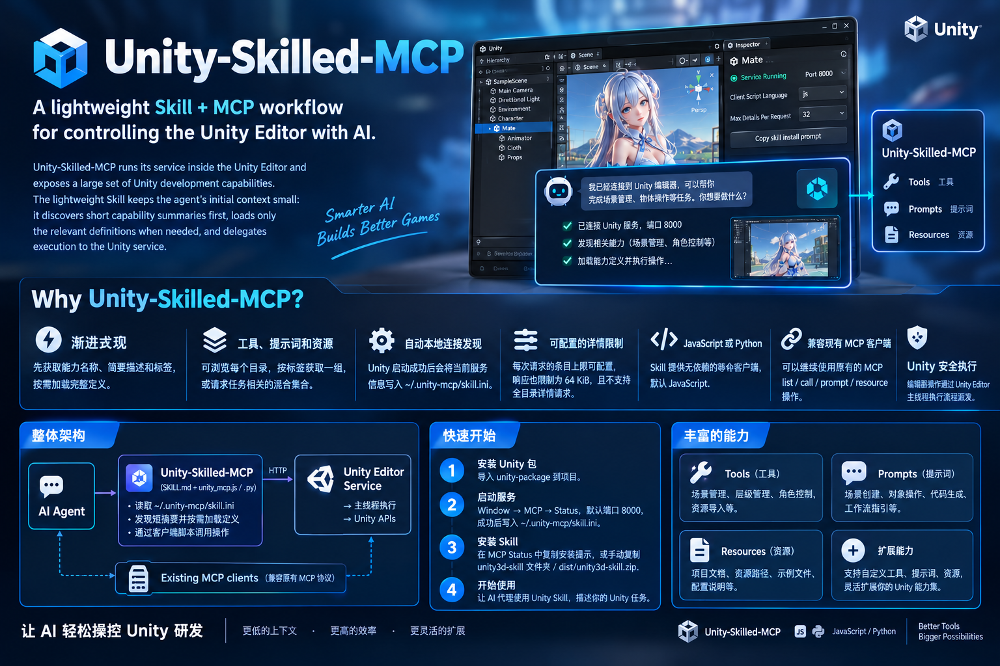

[English](README.md) | **中文**

---

# Unity Skilled MCP 系统说明文档



## 目录
1. [系统概述](#系统概述)
2. [设计架构](#设计架构)
3. [工具框架](#工具框架)
4. [源码结构](#源码结构)
5. [使用方法](#使用方法)
6. [Agent 技能模块](#agent-技能模块)
7. [HTTP 发现 API](#http-发现-api)
8. [扩展新工具](#扩展新工具)
9. [故障排除](#故障排除)

---

> **重要**：本文出现的工具名、动作与参数均为**源码内置能力示例**，不代表当前 Unity 服务一定可用。实际能力一律以技能脚本的 `discover` / `list` / `schema` 返回为准。
>
> 工具注册已改为**声明式 `ToolCatalog` + Attribute 反射**：一个动作即一个工具，名称形如 `分组.动作`（如 `animator.create`、`hierarchy.create_cube`、`gameobject.modify`），参数由各自的 `inputSchema` 精确声明。
>
> **状态树（StateTree）已彻底移除**：`StateTree` / `StateTreeBuilder` / `StateTreeContext` / `StateMethodBase` / `DualStateMethodBase` / `Selector/` 全部删除。工具类为**无状态树的普通类**，直接以 `[ToolModule]` + `[ToolAction]` 声明。旧的「大工具 + `action` 分派」名称（`hierarchy_create`、`edit_gameobject`、`code_runner` 等）已失效，不再提供兼容别名。
>
> 技能客户端只有 `unity_mcp.js`（Node.js 18+）；INI 与 Unity 设置中不再有脚本语言选项。批量调用接口 `batch_call` 与技能 `calls` / `callMany` 已移除，多步操作请用技能库 API 自行编排。

## 系统概述

*Unity Skilled MCP —— 连接 AI 与 Unity 的桥梁，实现智能化游戏开发*

Unity Skilled MCP 是一个 AI–Unity 集成系统：它在 Unity 编辑器内运行一个轻量 MCP 服务，把大量 Unity 开发能力以「**一个动作 = 一个工具**」的粒度暴露出来；同时提供一份**不内联任何能力清单**的轻量技能，让 AI 助手（Cursor、Claude、Trae 等）先发现、再取定义、后调用，从而把常驻上下文压到几 KB。

### 核心价值
- **AI 驱动开发**：通过自然语言指令控制 Unity 编辑器
- **动作即工具**：每个工具参数明确、`inputSchema` 精确，不再「一堆参数塞进一个大函数」
- **省 Token**：渐进式发现，先拿短目录，需要时再读定义
- **高性能**：基于 HTTP 的 JSON-RPC 2.0，消息队列主线程安全执行
- **可扩展**：新增工具只需在一个类上加 Attribute，无需任何额外声明文件
- **零外部依赖**：Unity 内置 MCP 服务器；技能客户端仅需 Node.js 18+

### 系统组成
- **内置 MCP Server** (C#)：Unity 编辑器内置的 MCP 协议服务器
- **Unity Package** (C#)：完整的 Unity 编辑器插件（`unity-package`）
- **Runtime Package** (C#)：独立精简运行时包（`unity-runtime-package`，供 Player 侧使用）
- **Agent 技能**：`unity-package/Skills/unity-skilled-mcp/`，Node.js 客户端 + 说明书
- **通信协议**：HTTP（可自定义端口，默认 8000）+ JSON-RPC 2.0

---

## 设计架构

### 整体架构

```
AI 客户端（Cursor / Claude / Trae）
  └─ Unity 轻量技能（SKILL.md + unity_mcp.js）
       ├─ 读 ~/.unity-mcp/skill.ini，校验在线服务
       ├─ 经 HTTP 发现短目录，按需读取所选能力定义
       └─ 经客户端脚本发起调用
            └─ Unity 编辑器服务 → 消息队列 → 主线程执行 → Unity API

既有 MCP 客户端 ─────────────────────────────────┘（兼容保留）
```

系统自上而下：
1. **AI 客户端层**：Cursor、Claude、Trae 等 AI 助手
2. **技能层**：`SKILL.md` 契约 + `unity_mcp.js` 客户端
3. **MCP 协议层**：Unity 内置 MCP 服务器（HTTP + JSON-RPC 2.0）
4. **执行层**：消息队列 → Editor 主线程 → Unity API
5. **工具层**：43 个工具模块（364 个动作）+ 4 个内置入口（demo 另含 7 个自定义工具模块示例）

#### 系统架构图


*图1：Unity Skilled MCP 系统整体架构图，展示从 AI 客户端到 Unity 编辑器的完整数据流与组件关系*

#### 数据流图


*图2：数据流图，展示从 AI 指令到 Unity 执行的完整数据流转过程*

### 核心设计原则

**1. 动作即工具（细粒度）**

每个动作都是独立工具，名称形如 `分组.动作`，参数由各自的 `inputSchema` 精确声明。例如 `animator.create` 只有 `path`，`hierarchy.create_cube` 参数完整，`gameobject.modify` 含 `path` / `instance_id` 目标定位参数。不再有 `action` / `source` 这类隐式首键分派。

**2. Attribute 声明 + 反射发现（唯一真源）**

- `[ToolModule(prefix, GroupEn, GroupZh)]` 标模块类（如 `[ToolModule("animator", GroupEn = "Animation", GroupZh = "动画与特效")]`）
- `[ToolAction(action, "param", "required=require")]` 标 handler 方法（一个方法可声明多个动作）
- `[ToolParam(name)]` 标参数（可标在方法上，也可标在强类型参数上）
- `ToolCatalog.Reload()` 纯反射扫描全部 `[ToolModule]` 真实顶层类 → 绑定 handler 委托 → 从 `Keys` 解析参数元数据 → 生成精确 `inputSchema`
- **不再需要任何生成的 `*.Tools.cs` 声明文件，也不经状态树分派**

**3. 无状态树的分发**

`ToolCall.HandleCommand` 命中工具名后直接 `MethodInfo.Invoke` 绑定方法；如需目标对象，实现 `ITargetedTool.ResolveTarget(ToolContext)` 在 handler 前一次性解析并存入 `_resolved_targets`。

**4. 智能连接管理**
- 可自定义端口（默认 8000）
- 消息队列处理机制
- 主线程安全执行保障

---

## 工具框架

框架位于 `unity-package/Editor/ToolFramework/`：

| 文件 | 职责 |
| --- | --- |
| `ToolAttributes.cs` | `ToolModuleAttribute` / `ToolActionAttribute` / `ToolParamAttribute` 定义 |
| `ToolCatalog.cs` | 反射扫描全部 `[ToolModule]` 类并绑定 handler，**唯一真源** |
| `ToolSpec.cs` | 单个工具的元数据（名称、分组、参数、注入、handler 委托） |
| `ToolSchema.cs` | 为每个工具生成精确 `inputSchema` |
| `ToolCall.cs` | 执行单个工具（每次调用新建实例，无共享分发状态） |
| `ToolContext.cs` | 单次调用上下文（`JsonData` + `ObjectReferences` 双字典、索引器、`Complete` / `AsyncReturn`） |
| `ToolModuleBase.cs` | 工具模块基类，含 `ITargetedTool` 契约 |
| `ToolTargetResolver.cs` | 目标定位（`TargetScope { Any, Hierarchy, Project }`） |

### 一个工具模块的最小形态

```csharp
[ToolModule("animator", GroupEn = "Animation", GroupZh = "动画与特效")]
public class AnimatorTool : ToolModuleBase
{
    public override string Description => L.T("Manage Animator controllers", "管理动画控制器");

    // 参数名对应 CreateKeys() 中的 MethodKey；框架反射解析出精确 inputSchema
    protected override MethodKey[] CreateKeys() => new MethodKey[]
    {
        new MethodStr("path", L.T("Controller asset path", "控制器资源路径"), false),
    };

    [ToolAction("create", "path=require")]
    private object CreateController(JsonClass args) { /* ... */ }
}
```

也可用强类型参数：`public object Create([ToolParam("path")] string path)`，框架会按名从 JSON 取值并转换。

### 目标定位（可选）

操作已存在对象的模块可实现 `ITargetedTool`，框架在 handler 运行前解析目标并存入 `_resolved_targets`：

```csharp
public object ResolveTarget(ToolContext ctx)
    => ToolTargetResolver.Resolve<GameObject>(ctx, TargetScope.Hierarchy);
```

`TargetScope.Any` 覆盖场景与项目资源，`Hierarchy` 仅场景对象，`Project` 仅项目资源。解析失败返回 `Response.Error`，框架中止本次调用并原样回报。

---

## 源码结构

### Unity 内置 MCP 服务器

```
unity-package/Editor/Connect/
├── McpService.cs               # 内置 MCP 服务器核心（HTTP + JSON-RPC + 消息队列）
├── McpDiscovery.cs             # 发现快照、连接信息、INI 发布
└── McpDiscoveryTests.cs        # 发现链路自检（Unity 菜单：Tools/Unity MCP/Run Discovery Self Tests）
```

**关键组件**

```csharp
// 主线程安全执行
private void EnqueueTask(Action task)      // 入队 + 注册 EditorApplication.update
private void ProcessMessageQueue()          // 出队执行 + 自动注销

// 工具装载（声明式）
private void DiscoverTools()
{
    RefreshToolInfos();      // ToolCatalog.Reload() + 4 个内置入口
}
```

### Unity 编辑器扩展

```
unity-package/Editor/
├── Connect/                   # MCP 服务与发现
├── Executer/                  # 执行器（AsyncCall / CoroutineRunner / McpTool / MethodKey / ToolNameAttribute）
├── ToolFramework/            # Attribute 反射框架（见「工具框架」）
├── Tools/                    # 工具模块：一个 [ToolModule] = 一个真实顶层类
│   ├── Hierarchy/            # HierarchyApplyTool / HierarchyCreateTool / HierarchySearchTool
│   ├── Projet/               # ProjectCreateTool / ProjectOperateTool / ProjectSearchTool
│   ├── Console/ConsoleTool.cs        # 控制台（单类暴露 14 个 console.* 工具）
│   ├── ResEdit/              # AnimatorTool / AnimClipTool / GameObjectTool / MaterialTool / MeshTool ...
│   ├── RunCode/              # CodeTool / PythonTool
│   ├── UI/                   # UGUILayoutTool / UiToolkitTool
│   ├── Window/               # GameViewTool / CameraTool / SceneViewTool
│   ├── Setting/              # PackageTool / TagLayerTool
│   ├── Storage/              # PrefersTool / SourceLocationTool
│   ├── BaseEditorTool.cs / EngineTool.cs / GamePlayTool.cs / ObjectTool.cs / HttpTool.cs / TestsTool.cs
├── Model/                    # 数据模型（Response / McpSettings / AsyncCallResultStore ...）
├── GUI/                      # MCP 状态窗口、调试窗口
├── Provider/                 # 设置提供者
├── Utils/                    # 工具类库（ConsoleUtils / GameObjectUtils / MenuUtils ...）
└── Unity.Mcp.Editors.asmdef
```

> `StateTree/` 与 `Selector/` 目录**已删除**。

### Runtime Package（独立精简运行时）

```
unity-runtime-package/Runtime/
├── Connect/                  # RuntimeMcpService / McpRequest / McpResponse / ToolInfo
├── Executer/                 # McpTool / IToolMethod / StateTreeContext / ToolsCall / ToolNameAttribute
├── Model/                    # MethodKey / Response
└── Utils/                    # RuntimeLogger / SimpleJson
```

> **注意**：运行时包是**独立程序集**，面向 Player 侧，未随 Editor 侧移除状态树。Editor 侧 demo 中 `Assets/Runtime/RuntimeToolsExample.cs` 使用该包的 `IToolMethod` + `StateTreeContext`，属预期，不受 Editor 重构影响。

### 工具模块分类

当前 `unity-package/Editor/Tools/` 共 **55 个 `[ToolModule]`、446 个 `[ToolAction]`**，按 **10 个功能分组**组织（分组即 `groups` 命令返回的标签来源，由模块的 `GroupEn` / `GroupZh` 决定）：

| 分组 | 标签 | 模块前缀（动作数） |
| --- | --- | --- |
| **场景层级** | `scene` | `hierarchy` (22)、`gameobject` (6)、`scene` (16)、`component` (2)、`object` (1) |
| **资源资产** | `assets` | `terrain` (14)、`prefab` (13)、`mesh` (11)、`model` (10)、`material` (9)、`audio` (14)、`script` (6)、`sprite_atlas` (6)、`scriptable_object` (5)、`shader` (4)、`texture` (3)、`asset` (7) |
| **动画与特效** | `animation` | `animator` (20)、`effects` (12)、`anim_clip` (10)、`particle` (9)、`animation` (8) |
| **界面** | `ui` | `ui` (20)、`ugui` (3) |
| **编辑器** | `editor` | `console` (14)、`camera` (11)、`scene_view` (9)、`game_view` (8)、`editor` (12) |
| **运行与调试** | `runtime` | `gameplay` (18)、`engine` (17)、`tests` (3)、`runtime` (6)、`optional_runtime` (4) |
| **项目工程** | `project` | `project` (39)、`package` (10)、`tag_layer` (6) |
| **系统工具** | `system` | `http` (8)、`capability` (6)、`prefers` (6)、`source_location` (5)、`python` (4)、`code` (3)、`system` (7) |
| **物理与导航** | `physics` | `physics` (9) |
| **渲染与光照** | `rendering` | `rendering` (10) |

> 12 个扩展实现模块使用简短前缀 `scene` / `asset` / `animation` / `ui` / `editor` / `runtime` / `project` / `system` / `physics` / `rendering` / `audio` / `optional_runtime`。`scene`、`ui`、`editor`、`project`、`audio` 与旧模块共用前缀，表中动作数已合并；实现模块数仍为 55。**旧工具名称与动作不变，扩展工具不再使用 `_workflow` 后缀，也不注册旧前缀别名**。它们共用 `unity-package/Editor/Utils/ExtensionSafety.cs`：必填/未知参数拒绝、类型与枚举校验、数字范围、`Assets/` 路径与符号链接校验、场景对象校验、`Undo` + `SetDirty`。严格校验只对新模块生效（`IStrictToolModule`），旧模块行为不变。

> 分组用于 `groups` / `details --tag` 的现场发现，**不改变工具名**：工具名始终为 `前缀.动作`（如 `hierarchy.create_cube`、`animator.create`）。
>
> 可选包（Cinemachine、VFX Graph、Test Framework）均通过运行时反射访问，未安装时**不影响其余工具编译与使用**，对应工具返回明确的「未安装」提示。
>
> `capability` 为**内置自省模块**，把 MCP 三原语（tools / prompts / resources）的管理面暴露给 AI：`list` 发现、`get` 查详情、`set` 启停（工具支持整组前缀，如 `texgen`）、`save` / `remove` 增删可配置的提示词与资源、`settings` 读写通用设置。改动即时重发现并失效列表缓存；`capability.set` 为恢复通道，禁止自锁禁用。

demo 工程另含 `demo/Assets/Extends/CustomTools/` 下的**自定义扩展工具示例**（不随包分发，演示如何扩展）：`cmd` (1)、`asset_index` (9)、`webpage` (7)、`figma` (4)、`ui_rule` (5)、`probuilder` (14，需 ProBuilder 包)，以及 `texgen` (7)——**程序化贴图引擎**：矢量图元 + SDF 光栅化 + 渐变/噪波/混合，导出 PNG（纯 C#，零外部依赖）。demo 合计 7 模块 / 47 动作。

> 扩展模块与内置模块共用同一套分组：`figma` / `ui_rule` 归 **界面**，`texgen` / `probuilder` 归 **资源资产**，`cmd` / `asset_index` / `webpage` 归 **系统工具**。接入后直接出现在对应 `groups` 标签下。

---

## 使用方法

### 1. 环境准备

- Unity 2021.3+（本项目在 2021.3.45f2c1 验证）
- 支持 MCP 协议的 AI 客户端（Cursor / Claude / Trae 等）
- Windows / macOS / Linux
- 技能客户端仅需 **Node.js 18+**，无第三方依赖

### 2. 安装与启动

1. 将 `unity-package` 导入 Unity 项目（`unity-runtime-package` 视需要导入）。
2. 在 Unity 中打开 **Window → MCP → Status**，确认设置后启动服务，默认端口 `8000`。
3. 每次成功启动会把当前连接与技能运行设置写入：

```text
~/.unity-mcp/skill.ini
```

改端口在服务重启后生效；最后成功启动的 Unity 项目会覆盖该文件。

### 3. Unity 编辑器配置

- **MCP 设置窗口**（`Edit → Project Settings → MCP`）：连接开关、已注册工具列表、端口、日志级别、UI 设置、Figma 设置。

  

- **MCP 调试窗口**（`Window → MCP → Debug Window`）：调用记录、执行结果、时间戳、重新触发、过滤搜索、导出日志。

  

### 4. Unity 设置与连接文件

| 设置 | 取值 | 默认 / 行为 |
| --- | --- | --- |
| 服务端口 | 合法端口号 | `8000` |
| 单次请求详情上限 `max_details` | 非负整数 | `32`；`0` 取消数量上限 |

即使数量上限为 `0`，**响应字节上限仍为 65,536 UTF-8 字节**；一次选择全部可用能力会被拒绝；服务不会静默截断超限结果。

```ini
[unity3d-skilled-mcp]
base_url=http://localhost:8000
port=8000
project_path=/path/to/UnityProject
process_id=12345
updated_at=2026-11-06T02:00:00.0000000Z
max_details=32
```

INI 只含本地连接元数据与启动设置，**不发布 `mcp_url`**，也不再发布脚本语言字段。技能客户端每次命令重新读取并校验服务；不扫端口、不自动重放写操作。

### 5. 基本使用

在 AI 客户端中直接描述任务，客户端会先发现、再调用。例如「创建一个 Cube 并放到 (0,1,0)」「把控制台的报错整理出来」。

### 6. MCP 客户端配置（兼容路径）

既有 MCP 客户端可继续直连，无需安装技能：

```json
{
  "mcpServers": {
    "unity3d-mcp": {
      "url": "http://localhost:8000"
    }
  }
}
```

常见客户端配置位置：`~/.cursor/mcp.json`、`~/AppData/Roaming/Claude/claude_desktop_config.json`、`~/.vs/mcp.json`、`~/.trae/mcp.json`。

### 7. 多步操作编排

批量调用接口已移除。需要连续执行多个调用时，用技能的 JS 库 API 自己写循环：先取定义、再按次序逐次 `callSkill`；遇错是否继续、失败后重放哪些步骤，都由调用方代码决定。每次调用独立校验 INI 与 discovery，写操作不自动回滚。

```js
const unity = require('./scripts/unity_mcp.js');
const catalog = await unity.listCapabilities('tools');
for (const step of await planFromCatalog(catalog)) {
  await unity.callSkill(step.name, step.args);
}
```

> 构建、切平台、重编译、测试运行期间不要与其他写操作并发。

---

## Agent 技能模块

MCP 协议会向 AI 提供完整工具列表与 Schema，工具较多时**占用大量 Token**。为降低上下文消耗，项目提供 **Skill 模块**（`unity-package/Skills/unity-skilled-mcp/`），实现「按需发现、按需取定义、用完即弃」。

### 铁律：先发现，后使用

- 技能**不载任何具体工具、动作、参数、枚举或能力之名**。工程注册何物、启用何物、缺包不可用何物，唯运行中的服务知之。
- 顺序固定：`discover` 验服务 → `groups` / `list` / `find` 定成员 → `details` / `schema` / `schemas` 取定义 → `call` 依定义调用。
- 工具名、提示词名、资源 URI、tag、参数及取值，**皆须出自本次服务返回**。禁凭记忆猜名；禁跳过发现径直 `call`；404/400 不是「换名再试」的信号。
- 参数语义**只以该工具本次 `schema` 为准**；不可逆操作先读确认参数说明，显式授权只能由调用方给出。

### 实现方式

- **统一技能入口**：一份 `SKILL.md` 说明连接方式、命令用法与安全边界，不内联任何工具参数。
- **渐进式发现**：先 `GET /groups` 与 `GET /tools` 只取名称、短说明和标签；需要参数时再取定义。
- **单个或批量 Schema**：`schema NAME` 读单个定义（`GET /tools/{name}/schema`）；`schemas A B C` 一次读多个（`POST /capabilities/schemas`），返回标准 `{name, description, inputSchema}`。
- **混合详情**：`details --tag TAG` 按标签组取详情；`details --members` 按本次任务自选工具 / 提示词 / 资源，三种类型可混。
- **目录检索**：`find QUERY [--kind tools|prompts|resources]` 只在本地对目录摘要做大小写不敏感过滤。
- **内容读取**：`details` 只给注册定义；`prompt NAME` 与 `resource URI` 先校验目录成员，再走 `prompts/get` / `resources/read` 取正文。
- **多步访问**：技能不提供批量调用接口；由调用方以库 API 编排。

### 技能命令示例

```sh
node scripts/unity_mcp.js discover
node scripts/unity_mcp.js groups
node scripts/unity_mcp.js list --kind tools
node scripts/unity_mcp.js find camera --kind tools
node scripts/unity_mcp.js schema NAME_FROM_LIST
node scripts/unity_mcp.js schemas NAME1 NAME2
node scripts/unity_mcp.js details --tag TAG_FROM_GROUPS
node scripts/unity_mcp.js call NAME_FROM_LIST --args-file args.json
node scripts/unity_mcp.js prompt NAME
node scripts/unity_mcp.js resource URI
```

所有 `NAME_FROM_LIST` / `TAG_FROM_GROUPS` / `URI` 均为占位符，必须换成 `list` / `groups` / `find` 返回的实际成员。

### 脚本作为库调用

`unity_mcp.js` 既是 CLI 也是零依赖 CommonJS 库，`require(...)` 后可用原生对象直接调用，让 AI 自己写代码组织多步访问。

```js
const unity = require('./scripts/unity_mcp.js');
unity.configure({ timeout: 15 });
const catalog = await unity.listCapabilities('tools');
const { name, args } = pickFrom(catalog, await unity.getSchema(name));
const summary = await unity.workflowContext('TASK', 'DESCRIPTION', async wf => {
  await unity.callSkill(name, args);
  return wf.summary();
});
```

- `pickFrom` 是伪代码，表示由调用方根据目录与 schema 选择工具和参数。
- `callSkill` 返回 MCP `result`；`callTool` 返回完整 JSON-RPC 信封；`*Text` / `*Json` 提取并解析 `content[*].text`。
- `workflowContext` 只记录调用（`wf.calls`、`wf.summary()`），不重试、不回滚；失败照常抛出。所有方法均为 `async`，异常为带 `.code` 的 `ClientError`。
- Windows Git Bash 会把 `request /ROUTE` 转成本地路径，客户端已按 `EXEPATH` 自动还原，也支持裸路由 `request groups`。

### 约束

- 单次详情与批量 Schema 的去重数量上限取 Unity 设置中的 `max_details`（默认 `32`，`0` 为不限），详情响应最多 65536 个 UTF-8 字节；超限返回 400/413，不静默截断、不自动分批。
- 拒绝 `all`、`*`、空值和未知字段；名称超过一项且覆盖全部已启用工具时按全集拒绝；未知或已禁用的工具返回 404。
- 多步编排无事务与回滚：写操作成功即生效，中途失败先以只读手段核状态，再决定余下步骤。

### 文件结构

```
unity-package/Skills/unity-skilled-mcp/
├── SKILL.md                    # 连接、命令与安全说明
├── scripts/
│   └── unity_mcp.js            # 唯一客户端，Node.js 18+，无依赖
└── tests/                      # 客户端回归测试
```

运行回归测试：

```sh
node --test tests/test_unity_mcp.js
```

---

## HTTP 发现 API

技能客户端使用以下发现路由：

| 路由 | 用途 |
| --- | --- |
| `GET /discovery` | 校验在线服务、读取非 MCP 连接元数据 |
| `GET /groups` | 列出可用标签及工具 / 提示词 / 资源计数 |
| `GET /tools` | 列出工具名、短说明与标签 |
| `GET /prompts` | 列出提示词名、短说明与标签 |
| `GET /resources` | 列出资源 URI、名称、短说明与标签 |
| `GET /tools/{name}/schema` | 读取单个工具完整 schema |
| `POST /capabilities/schemas` | 一次读取多个工具 schema |
| `POST /capabilities/details` | 按一个标签或显式混合 `members` 数组读详情 |

详情端点只接受一种选择模式：`{ "tag": "..." }` 或 `{ "members": [...] }`。拒绝空值、未知选择、通配 / 全集选择；重复成员只计一次。资源详情只描述注册元数据，不隐式读取正文。

Schema 端点接受 `{ "tools": ["name", ...] }`，返回 `{ "items": [{ "name", "description", "inputSchema" }], "count", "max_details" }`，按请求次序、重复计一次。它与详情共享 `max_details` 上限、64 KiB 响应上限、全集拒绝，未知 / 禁用工具返回 404。

### 既有 MCP 客户端

技能工作流是额外的访问路径，不替代既有 MCP 协议。当前 MCP 客户端可继续使用 `tools/list`、`tools/call`、`prompts/list`、`prompts/get`、`resources/list`、`resources/read`，无需安装技能。技能的发现请求不会改变这些 MCP 操作的行为。

---

## 扩展新工具

新增一个工具模块只需**一个文件**：

1. 在 `unity-package/Editor/Tools/` 下创建一个 `XxxTool.cs`（`namespace UniMcp.Tools`）。
2. 用 `[ToolModule("prefix", GroupEn = "...", GroupZh = "...")]` 标类，继承 `ToolModuleBase`。
3. 实现 `Description` 与 `protected override MethodKey[] CreateKeys()`。
4. 每个动作写一个 handler，标 `[ToolAction("action", "param", "required=require")]`。参数可为 `JsonClass`（原始 JSON）或 `ToolContext`（含对象引用、`AsyncReturn`）。
5. 若操作已存在对象，实现 `ITargetedTool.ResolveTarget`。
6. 直接编译即可——`ToolCatalog` 反射发现，无需注册、无需生成文件、无需 meta 之外的额外步骤。

```csharp
[ToolModule("mytool", GroupEn = "My Group", GroupZh = "我的分组")]
public class MyTool : ToolModuleBase
{
    public override string Description => L.T("...", "...");

    protected override MethodKey[] CreateKeys() => new MethodKey[]
    {
        new MethodStr("name", L.T("Name", "名称"), false),
    };

    [ToolAction("hello", "name=require")]
    private object HandleHello(JsonClass args)
        => Response.Success("ok", new { name = args["name"]?.Value });
}
```

---

## 故障排除

**连接问题**
- **无法连接 Unity**：确认编辑器已启动、服务已 Start、端口未被占用、防火墙放行；查看 Unity Console 错误。
- **连接频繁断开**：检查网络、Unity 卡顿、超时设置。

**发现 / 调用问题**
- **技能找不到服务**：确认服务在运行且 `~/.unity-mcp/skill.ini` 存在；改端口后须重启服务。
- **INI 与在线服务不一致**：重启目标 Unity 项目的 MCP 服务，让它重新发布设置。
- **某标签没有详情**：用 `groups` 取当前标签；标签随配置变化。
- **详情 / Schema 请求被拒**：减少所选组或成员数；检查 `max_details`；64 KiB 上限与全集拒绝仍然生效。
- **能力未列出**：检查是否在 Unity MCP 设置中启用、目标项目是否完成初始化。
- **调用失败**：查看 Unity Console 与 MCP 状态窗口的请求记录；确认参数 JSON 与所选定义一致。可选包（Cinemachine / VFX Graph / ProBuilder / Test Framework）未安装时，对应工具返回明确提示，属预期。

**性能问题**
- 响应慢：优化网络、关闭不必要的 Unity 功能、简化操作。
- 内存高：及时销毁对象、释放资源、检查协程生命周期。

---

## 相关文件

- 技能契约与完整命令参考：[`unity-package/Skills/unity-skilled-mcp/SKILL.md`](unity-package/Skills/unity-skilled-mcp/SKILL.md)
- 英文说明：[English README](README.md)
- 项目网站：[docs/index.html](docs/index.html)
- 改动记录：[note.md](note.md)

---

*文档版本：v3.0（声明式工具框架，无状态树）*
